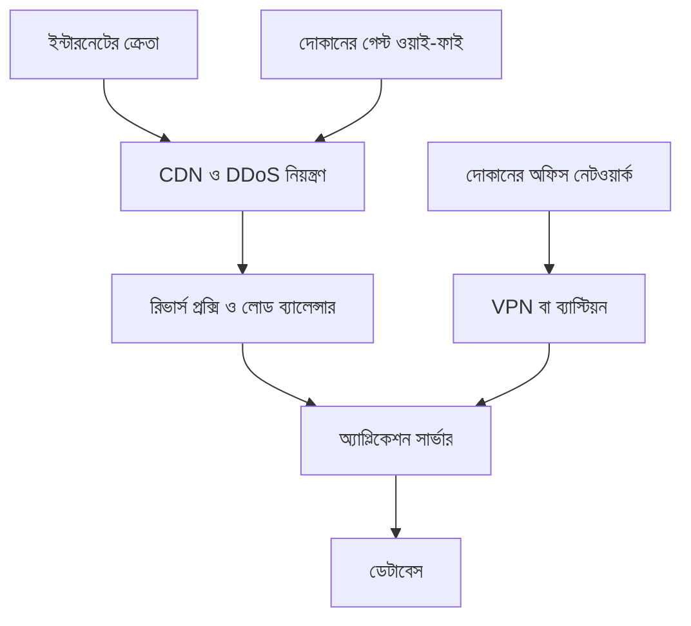

# আর্কিটেকচার

এই ছবি **শেষ লক্ষ্য**। অধ্যায় ৩৫ এটাকে বর্তমান নকশা হিসেবে পড়তে পারে। তার আগের অধ্যায় এটাকে "এখন যা চলছে" ধরে না। কখন কোন অংশ আসে, [timeline.md](timeline.md)।

শুরুর সিস্টেম একটা অ্যাপ্লিকেশন সার্ভার। সেই ছবি [প্রথম অধ্যায়](../series/season-1-request-journey/01-request-journey/README.md)-এ।

ছবিগুলো ধারণা। কোনো ক্লাউড বিক্রেতা, কেবল, বা কনফিগারেশন ফাইল এখানে নেই।

## শুরু, অধ্যায় ১

ক্রেতা সরাসরি ওই সার্ভারে পৌঁছায়। ডেটা সেই সার্ভারে। দোকানের আলাদা নেটওয়ার্ক নকশা এই ছবিতে নেই।

## লক্ষ্য, অধ্যায় ৩৫

প্রশ্ন: ক্রেতার ফোন, দোকানের গেস্ট ফোন, কর্মীর ল্যাপটপ, ও আরিফের অ্যাডমিন পথ কি একই জায়গায় গিয়ে শেষ হয়?

গেস্ট ফোন ইন্টারনেটের দিকে বেরোয়, তাই জনমুখী সাইট অন্য যেকোনো ক্রেতার মতো খুলতে পারে। অফিস নেটওয়ার্ক, অ্যাডমিন পথ, অ্যাপ সার্ভারের প্রাইভেট ঠিকানা, ও ডেটাবেসের দিকে তার আলাদা তীর নেই। ছবি সেই অনুপস্থিত তীর প্রমাণ করে না। প্রমাণ হয় কনফিগারেশন ও টেস্টে। অধ্যায় ১৯–২২ সেই কথা বলে।

অফিস থেকে অ্যাডমিন পথ আলাদা। গেস্ট ফোন সেই পথ পায় না।

লোড ব্যালেন্সারের পিছনের অ্যাপ্লিকেশন সার্ভার একাধিক হতে পারে। ছবিতে এক বাক্স সেই ভূমিকা। ডেটাবেসে খোলা ইন্টারনেট থেকে সরাসরি তীর নেই। অ্যাপ্লিকেশন সার্ভার সেখানে পৌঁছায়।

## অংশ ও যে অধ্যায় আনে

| অংশ | লক্ষ্য নকশায় কী করে | আসে |
| --- | --- | --- |
| ক্রেতার ব্রাউজার | পণ্যের পাতা চায় | অধ্যায় ১ |
| একক অ্যাপ্লিকেশন সার্ভার | শুরুর পুরো অ্যাপ ও ডেটা | অধ্যায় ১ |
| জনমুখী নাম ও HTTPS | ক্রেতার লিঙ্ক | অধ্যায় ১, বিস্তার অধ্যায় ৭–৯ ও ১৩–১৭ |
| গেস্ট ওয়াই-ফাই | দোকানের ক্রেতার ইন্টারনেট, আলাদা সীমানা | অধ্যায় ১৯–২১ |
| অফিস নেটওয়ার্ক | কর্মীর যন্ত্র | অধ্যায় ২১ |
| ফায়ারওয়াল ও ACL | জোনের মধ্যে কোন পথ খোলা | অধ্যায় ২২ |
| রিভার্স প্রক্সি ও লোড ব্যালেন্সার | সামনের দরজা, একাধিক সার্ভারে ভাগ | অধ্যায় ২৫–২৬ |
| একাধিক অ্যাপ্লিকেশন সার্ভার | একটি মেশিন থামলেও কিছু ক্ষমতা থাকে | অধ্যায় ২৭ |
| ডেটাবেস জোন | অর্ডার ও ক্রেতার তথ্য, আরও সীমিত পথ | অধ্যায় ২৭ |
| সার্ভিস ডিসকভারি | সার্ভার বদলালে ঠিকানা খুঁজে পাওয়া | অধ্যায় ২৮ |
| CDN, রেট লিমিট, DDoS নিয়ন্ত্রণ | এজের ট্রাফিক | অধ্যায় ২৯ |
| ক্লাউড সাবনেট | পাবলিক ও প্রাইভেট জোনের একটি রূপ | অধ্যায় ৩০ |
| লগ, মেট্রিক, ক্যাপচার | ভাঙন দেখা | অধ্যায় ৩১ |
| VPN বা ব্যাস্টিয়ন | আরিফের অ্যাডমিন পথ | অধ্যায় ৩৩ |

## এই ছবি যা করে না

একটি তীর "নিরাপদ" লেখে না। ফায়ারওয়াল, প্রাইভেট সাবনেট, বা VPN থাকলেও অ্যাপ্লিকেশনকে অনুমতি আলাদা করে দেখতে হয়। লোড ব্যালেন্সার অ্যাপ্লিকেশনের বাগ সারায় না। CDN সব দুর্যোগ সামলায় না।

ক্লাউড বিক্রেতার আসল অ্যাকাউন্ট, সিকিউরিটি গ্রুপের কপি, বা সার্টিফিকেটের প্রাইভেট কী এখানে নেই।
