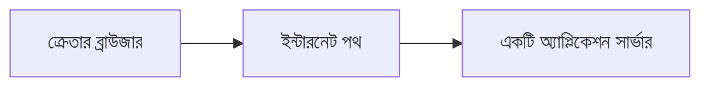
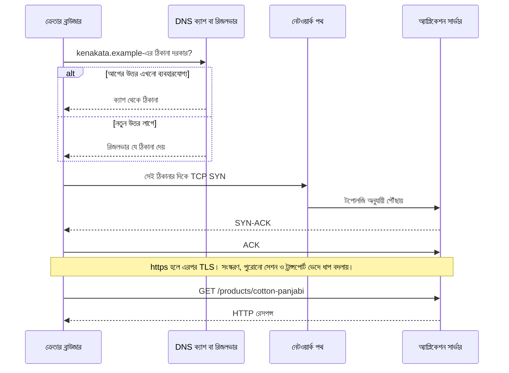
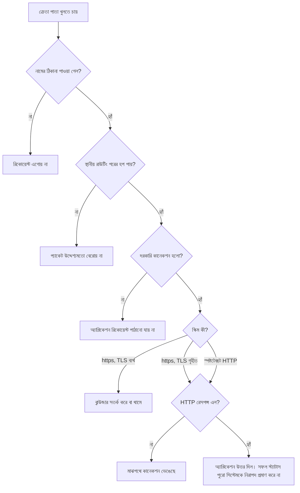

# ব্রাউজার থেকে সার্ভার: একটি Request-এর যাত্রা

রবিবার দুপুর। রাফির পোশাকের দোকানে ভিড়। একজন ক্রেতা ফোনে একটি লিঙ্ক খোলেন। সুতি পাঞ্জাবির পাতা। কিছুক্ষণ পর কাপড়ের ছবি ও দাম সামনে আসে।

পরের দিন সকালে রাফি আরিফকে ফোন করেন। সাফল্যের খবর দিতে নয়।

"কাল রাতে একজন বলল, পাতাই খুলছে না। আমি নিজের ফোনে খুলে দেখলাম, আমারটা আসছে। আপনি বললেন সার্ভার চলছে। তাহলে ওরটা কেন আসে না?"

আরিফের স্ক্রিনে অ্যাপ্লিকেশনের প্রসেস সত্যিই চলছিল। নীরা পাশে থেকে জিজ্ঞেস করলেন, "সার্ভার চলা আর ক্রেতার পাতা খোলা কি এক ঘটনা? না হলে আমরা কোথায় খুঁজব?"

এই অধ্যায় সেই খোঁজার মানচিত্র। DNS, রাউটিং, TCP, বা TLS-এর পূর্ণ বিবরণ এখানে নেই। প্রতিটির জন্য আলাদা অধ্যায় আছে। এখানে লক্ষ্য হলো যাত্রাটাকে এক কথায় গুলিয়ে না ফেলা।

## এই অধ্যায়ে কী বুঝবে

- একটি পণ্যের পাতা খোলাকে কয়েকটি আলাদা প্রশ্নে ভাঙতে পারবে।
- নাম, ঠিকানা, স্থানীয় পথ, TCP, TLS, ও HTTP একই সাফল্য নয়।
- কোন ধাপ সফল হলে কী প্রমাণ হয়, আর কী প্রমাণ হয় না।
- এই মুহূর্তের KenaKata একটা সার্ভার। সামনে লোড ব্যালেন্সার নেই।

## আগে কী লাগবে

প্রোগ্রামিং ও HTTP-র সাধারণ ব্যবহার জানা থাকলেই হয়। রাউটার, সকেট, বা সার্টিফিকেট আগে থেকে বোঝার দরকার নেই।

কয়েকটি শব্দ এই অধ্যায়ে এই অর্থে ব্যবহার হবে।

| শব্দ | এই অধ্যায়ে |
| --- | --- |
| Client | যে রিকোয়েস্ট পাঠায়। এখানে ক্রেতার ব্রাউজার |
| Server | যে সেবা দেয়। এখানে KenaKata-র একটি অ্যাপ্লিকেশন সার্ভার |
| Request | ক্লায়েন্টের প্রশ্ন। যেমন, এই পণ্যের পাতা দাও |
| Response | সার্ভারের উত্তর। পাতার HTML, বা একটি ত্রুটি |
| Packet | নেটওয়ার্কে চলা এক টুকরো ডেটা। স্তরভেদে এর নাম আলাদা। সেটা অধ্যায় ৬ |

বাকি সংক্ষিপ্ত অর্থ [শব্দকোষে](../../../notes/glossary.md)।

## এখন সিস্টেমে কী আছে

KenaKata এখন ছোট। রাফির দোকানের সার্ভার-রেন্ডারড ওয়েবসাইট। একটি অ্যাপ্লিকেশন সার্ভার। পণ্যের পাতা সবার জন্য খোলা। ক্রেতা লগইন করে না। অর্ডার ও পণ্যের ডেটা এই সার্ভারেই থাকে।

ক্রেতার লিঙ্ক `https://kenakata.example/products/cotton-panjabi`। `kenakata.example` ডকুমেন্টেশনের নাম, RFC 2606। আসল দোকানের রেজিস্টার্ড ডোমেইন নয়। সার্ভারের উদাহরণ ঠিকানা `203.0.113.10`। এটি RFC 5737-এর ডকুমেন্টেশন ব্লক। KenaKata-র আসল মেশিন নয়।



এই ছবি শুরুর অবস্থা। রিভার্স প্রক্সি নেই। দ্বিতীয় সার্ভার নেই। দোকানের গেস্ট ওয়াই-ফাইয়ের নকশা এখনো নেই। ভৌত দোকান ব্যবসা হিসেবে আছে, কিন্তু তার নেটওয়ার্ক এই অধ্যায়ের ঘটনা নয়। পরে কী যোগ হবে, [টাইমলাইনে](../../../product/timeline.md)। শেষ লক্ষ্যের বড় ছবি [আর্কিটেকচারে](../../../product/architecture.md)। সেটি এখনকার সিস্টেম নয়।

## ১. সমস্যা

রাফির দুই পর্যবেক্ষণের মাঝে ফাঁক।

- তাঁর নিজের ফোনে পাতা আসে।
- আরেকজন ক্রেতার ফোনে আসে না।
- আরিফের সার্ভারে প্রসেস চলছে।

আরিফের প্রথম উত্তর: "ব্রাউজার সার্ভারকে বলে, সার্ভার পাতা পাঠায়। প্রসেস চলছে, তাই নেটওয়ার্ক ঠিক আছে। সমস্যা ওই ক্রেতার ফোনে।"

নীরা সেই উত্তর ধরেন। প্রসেস চলা কি প্রমাণ করে যে ওই ক্রেতার ফোন সার্ভার পর্যন্ত পৌঁছেছে? পৌঁছালেও কি প্রমাণ করে যে পাতাটি সঠিক উত্তর পেয়েছে?

প্রথম উত্তরটি একটি বাক্যে অনেকগুলো ঘটনা লুকায়। লুকানো থাকলে খোঁজা যায় না। ক্রেতার ফোন সত্যিই খারাপ হতে পারে। সেটা সম্ভাবনার একটি। বাকি সম্ভাবনা বাদ দিয়ে সেটাকে সিদ্ধান্ত বানানো যায় না।

## ২. লিঙ্কটি কী বলছে

`https://kenakata.example/products/cotton-panjabi`

তিনটি অংশ এখানে দরকার।

| অংশ | উদাহরণ | কী কাজ |
| --- | --- | --- |
| স্কিম | `https` | কোন নিয়মে কথা বলতে হবে |
| হোস্ট | `kenakata.example` | কোন নামের সার্ভার |
| পাথ | `/products/cotton-panjabi` | সেই সার্ভারে কোন জিনিস |

URI-র এই গঠন RFC 3986-এ। `https` স্কিম RFC 9110-এ। স্কিম `https` হলে HTTP চলে TLS-এর ওপর। স্কিম `http` হলে সেই TLS ধাপ থাকে না। KenaKata-র জনমুখী লিঙ্ক `https`।

পাথ অ্যাপ্লিকেশনের বিষয়। নেটওয়ার্ক `cotton-panjabi` বোঝে না। নেটওয়ার্ক বাইট পৌঁছে দেয়। কোন পণ্যের ছবি দেখাবে, সেটা অ্যাপ্লিকেশন ঠিক করে।

## ৩. নাম থেকে ঠিকানা

হোস্ট একটি নাম। প্যাকেট চলে ঠিকানা দিয়ে। তাই কোথাও নামের একটি ঠিকানা লাগে। এই কাজের নাম DNS।

প্রতিটি ক্লিকে পুরো খোঁজ হয় না। আগের উত্তর ক্যাশে থাকতে পারে। RFC 1034 বলে, TTL নির্দেশ করে একটি রেকর্ড ক্যাশ থেকে ফেলার আগে কতক্ষণ রাখা যায়। একই নামের জন্য দুই ক্যাশে দুই উত্তর থাকতে পারে, যদি একটি এখনো পুরোনো রেকর্ড ধরে রাখে। "সারা বিশ্ব ২৪ থেকে ৪৮ ঘণ্টায় বদলায়" এমন কোনো প্রোটোকল নিয়ম নেই। ক্যাশ ও TTL-এর বিস্তার অধ্যায় ৯। রুট সার্ভার পর্যন্ত পুরো হাঁটা অধ্যায় ৮।

এই অধ্যায়ে যথেষ্ট তিনটি কথা।

1. নাম না মিললে ব্রাউজারকে পাঠানোর ঠিকানাই জানা নেই। TCP শুরু হয় না।
2. উত্তর আসতে পারে ক্যাশ থেকে, অথবা একটি রিজলভার থেকে। ক্লায়েন্ট নিজেই প্রতিবার রুট সার্ভারে যায় না।
3. যে ঠিকানা এল, সেটি এই মুহূর্তের এই উত্তর। সার্ভার সুস্থ, এমন প্রমাণ নয়।

আরিফ যদি সার্ভারে বসে `kenakata.example` দেখেন, আর ক্রেতার ফোন অন্য উত্তর পায়, দুই জায়গার সাফল্য এক নয়।

## ৪. ঠিকানা ও পরের হপ

ধরা যাক উত্তর এল `203.0.113.10`। এটি গন্তব্যের উদাহরণ। যে মানুষ ক্লিক করল, তার পরিচয় নয়। অনেক বাড়ি ও মোবাইল নেটওয়ার্কে একই পাবলিক ঠিকানার পিছনে অনেক যন্ত্র থাকে।

ক্রেতার ফোন নিজে হয়তো `192.168.1.25`। গেটওয়ে `192.168.1.1`। এই জোড়া ক্রেতার নিজের নেটওয়ার্কের উদাহরণ, RFC 1918। KenaKata-র ইনভেন্টরি নয়।

ফোনের রাউটিং টেবিল জিজ্ঞেস করে, এই গন্তব্য কি আমার নিজের লিংকে? RFC 1122 এই সিদ্ধান্তকে লোকাল ও রিমোট বলে। লোকাল না হলে প্যাকেট যায় নির্বাচিত গেটওয়ের কাছে। গেটওয়ে পরের নেটওয়ার্কের দিকে এগিয়ে দেয়। পথে আরও রাউটার থাকতে পারে। কয়টি, সেটা টপোলজি বলে। একটি নির্দিষ্ট সংখ্যা প্রোটোকল দেয় না।

অনেক বাড়ির রাউটার NAT করে। তখন সার্ভার ফোনের `192.168.1.25` দেখে না। রাউটারের বাইরের ঠিকানা দেখে। উদাহরণ হিসেবে `198.51.100.25`, আরেকটি ডকুমেন্টেশন ব্লক। সব নেটওয়ার্কে NAT নেই। NAT-এর নিয়ম অধ্যায় ১১। এখানে শুধু এটুকু: সার্ভার যে ঠিকানা দেখে, সেটি ক্রেতার মানুষের প্রমাণ নয়।

ফিরতি পথ প্রতিটি হপে একই রাউটার দিয়ে আসবে, এমন বাধ্যবাধকতা নেই।

## ৫. একই লিংকে পৌঁছানো আলাদা কাজ

রাউটিং বলে পরের হপ কোন IP। সেই হপ পর্যন্ত ফ্রেম পৌঁছানো লিংক স্তরের কাজ। ইথারনেটে পরের হপের MAC ঠিকানা জানতে ARP লাগে। ওয়াই-ফাই হলে মাধ্যম অন্য। ধারণা একই রকম: এই তার, এই রেডিও, বা এই ভার্চুয়াল লিংকে পাশের ইন্টারফেসকে ফ্রেম দিতে হয়।

OSI মডেল এই স্তরগুলোর কথা বলার একটি উপায়। ITU-T X.200 সেই রেফারেন্স মডেল। সাতটি স্তর মানে পথে সাতটি যন্ত্র নয়। একটি ল্যাপটপ নিজেই একাধিক স্তরের কাজ করে। একটি রাউটার পুরো যাত্রার প্রতিটি স্তর নয়।

ইন্টারনেট মডেলের চার স্তরের ছবিও একটি শিক্ষার মডেল। RFC 1122 হোস্টের লিংক, ইন্টারনেট, ও ট্রান্সপোর্ট স্তরের দায় আলাদা করে। সেটিকে "প্রতিটি রিকোয়েস্ট এই বাক্সগুলো দিয়ে হাঁটে" এমন মানচিত্র বানানো যায় না।

## ৬. TCP কানেকশন

এই পাতার সাধারণ পথ TCP। নতুন কানেকশন হলে দুই পক্ষ হ্যান্ডশেক করে। RFC 9293-এর ভাষায় কানেকশন স্থাপন। সহজ ক্রম: ক্লায়েন্ট SYN পাঠায়, সার্ভার SYN-ACK পাঠায়, ক্লায়েন্ট ACK পাঠায়। তারপর বাইট স্ট্রিম চলে।

এই ক্রম প্রতিটি HTTP রিকোয়েস্টে নতুন করে হয় না। আগের TCP কানেকশন খোলা থাকলে HTTP/1.1 সেটি আবার ব্যবহার করতে পারে। RFC 9112 একে পারসিস্টেন্স বলে। HTTP/2 একই কানেকশনে অনেক স্ট্রিম চালাতে পারে। কোনটি হচ্ছে, সেটা ক্লায়েন্ট, সার্ভার, ও কনফিগারেশনের ওপর।

কিছু ক্লায়েন্ট `https`-এ HTTP/3 বেছে নেয়। তখন নিচের ট্রান্সপোর্ট TCP নয়। QUIC UDP-এর ওপর চলে, এবং TLS 1.3 ব্যবহার করে। RFC 9114 ও RFC 9000। এই অধ্যায়ের মূল ছবি TCP। ব্যতিক্রম জানা দরকার, যাতে ছবিটি একমাত্র পথ না হয়।

TCP উঠলে কী প্রমাণ হয়: এই মুহূর্তে ওই ঠিকানার ওই পোর্টে দুই পক্ষ কথা বলার রাস্তা পেয়েছে।

কী প্রমাণ হয় না:

- সার্টিফিকেট গ্রহণযোগ্য।
- পণ্যের পাতা আছে।
- অ্যাপ্লিকেশন সুস্থ উত্তর দেবে।
- সিস্টেম নিরাপদ।

হ্যান্ডশেক শেষ না হলে সূত্র দুই রকম হতে পারে। কেউ RST দিয়ে প্রত্যাখ্যান করতে পারে। উত্তর না এসে সময় শেষ হতে পারে। দ্বিতীয়টি একা ফায়ারওয়াল প্রমাণ করে না। পথে কোথাও প্যাকেট ফেলা, ভুল রাউট, বা সার্ভার না শোনা একই রকম দেখাতে পারে। বিস্তার অধ্যায় ৫।

## ৭. HTTPS ও TLS

স্কিম `https` হলে কানেকশনের ওপর TLS হয়। TLS 1.3-এর স্পেসিফিকেশন RFC 8446। তার ভূমিকায় বলা হয়েছে, TLS এমনভাবে কথা বলার জন্য যাতে ফাঁস, বদলানো, ও বার্তা জাল করা আটকানোর নকশা থাকে।

এই নকশা শর্তসাপেক্ষ। ক্লায়েন্ট সঠিক নামের সার্ভার যাচাই করছে, পুরোনো ভাঙা প্রোটোকল ব্যবহার হচ্ছে না, এবং ক্লায়েন্ট বা সার্ভার নিজে দখল হয়ে যায়নি। ব্রাউজারের সতর্কতা উপেক্ষা করা, ভুল ট্রাস্ট স্টোর, বা ফাঁস হওয়া প্রাইভেট কী এই লক্ষ্যের বাইরে চলে যায়। "TLS সব ম্যান-ইন-দ্য-মিডল আটকায়" বলা যায় না।

SSL 3.0 বর্তমান প্রোটোকল নয়। RFC 7568 বলে সেটি ব্যবহার না করতে। RFC 9325 SSL 2, SSL 3, TLS 1.0, ও TLS 1.1 নিয়ে নিষেধের সুপারিশ করে। একই নথি TLS 1.2 সমর্থন করতে বলে এবং TLS 1.3-কে অগ্রাধিকার দিতে বলে। হ্যান্ডশেকের বার্তা সংস্করণভেদে বদলায়। আগের সেশন থাকলে পুরো হ্যান্ডশেক আবার নাও হতে পারে। 0-RTT আলাদা ঝুঁকি আনে। সেই বিস্তার অধ্যায় ১৫। এখানকার কোনো সরল ছবি পুরো স্পেসিফিকেশন নয়।

সার্টিফিকেট আর প্রাইভেট কী এক জিনিস নয়। সার্টিফিকেট একটি দাবি, যা একটি কর্তৃপক্ষ সই করেছে। প্রাইভেট কী সার্ভারে থাকে। ক্রেতার কাছে পাঠানোর জিনিস সেটি নয়। নাম মেলানো এক পরীক্ষা। ট্রাস্ট চেইন আরেক পরীক্ষা। RFC 9525 সার্ভিসের পরিচয় যাচাইয়ের দিক ধরে। দুটোর পূর্ণ আলোচনা অধ্যায় ১৬ ও ১৭।

HTTPS ক্রেতাকে বলে না। সার্ভার জানে না এই ক্লিক রাফির কোন ক্রেতা। জনমুখী পণ্যের পাতায় সেই পরিচয় দরকারও নেই। দাম কে বদলাতে পারবে, সেটা অ্যাপ্লিকেশনের প্রশ্ন। Trust Stack সেই প্রশ্ন শেখায়। এই বই সেটি আবার শুরু করে না।

## ৮. HTTP ও অ্যাপ্লিকেশন

TCP ও TLS মিললে ক্লায়েন্ট HTTP রিকোয়েস্ট পাঠায়। এই দৃশ্যে মেথড `GET`, পাথ `/products/cotton-panjabi`। সার্ভারের অ্যাপ্লিকেশন পণ্য খুঁজে HTML বানায়। সেই বাইট উত্তর হয়ে ফেরে।

স্ট্যাটাস কোড অ্যাপ্লিকেশনের উত্তর। `200` মানে এই রিকোয়েস্টের জন্য সার্ভার একটি সফল রেসপন্স দিয়েছে। RFC 9110 স্ট্যাটাস কোডের অর্থ রাখে। `200` মানে নিচেরগুলো নয়।

- পুরো দোকান নিরাপদ।
- সব ক্রেতা পাতা পাচ্ছে।
- ডেটা সঠিক। ভুল দামও `200` নিয়ে আসতে পারে।
- পরের রিকোয়েস্ট সফল হবে।

`404` মানে এই পাথের জিনিস নেই। কানেকশন তখন উঠেছিল। `500` মানে সার্ভার ভিতরে ব্যর্থ হয়েছে। সেটিও নেটওয়ার্ক পৌঁছে দিয়েছে। উত্তর না এসে সংযোগ ছিঁড়লে স্ট্যাটাস কোডই নেই। সেই দুই ব্যর্থতা এক কথা নয়।

অ্যাপ্লিকেশন যাচাই করে এই পাতা সবার জন্য কি না। পণ্যের পাতা ইচ্ছে করে খোলা। খোলা পাতায় পৌঁছানো একটি গোপন কাজের অনুমতি নয়।

## ৯. পুরো যাত্রা একসঙ্গে

প্রশ্ন: ক্যাশ থাকলে কোন তীরটি আর লাগে না, আর HTTPS না হলে কোন নোটটি বাদ যায়?



ছবিটি একটি সম্ভাব্য ক্রম। এটি প্রমাণ করে ধাপগুলো এক জিনিস নয়। এটি প্রমাণ করে না যে প্রতিটি ক্লিক এই সব বার্তা নতুন করে পাঠায়।

বাদ পড়েছে: কয়টি রাউটার, NAT বদলালো কি না, ARP, HTTP/2 বা HTTP/3, TLS-এর ভিতরের বার্তা, সার্ভারের ভিতরের ডেটাবেস কল। শুরুর সিস্টেমে ডেটা এই সার্ভারেই। আলাদা ডেটাবেস হোস্ট নেই। তাই ছবিতে ডেটাবেসের তীর নেই।

দ্বিতীয় ছবি অন্য প্রশ্ন দেখে: যাত্রা কোন জায়গায় থামতে পারে?



স্পষ্টটেক্সট HTTP শাখা এই দোকানের জনমুখী লিঙ্ক নয়। শাখাটি রাখা হয়েছে যাতে TLS যেন বাধ্যতামূলকভাবে প্রতিটি ওয়েব রিকোয়েস্টের অংশ মনে না হয়। KenaKata-র ক্রেতার লিঙ্ক `https`।

## ১০. কোথায় থামে, কী সূত্র মেলে

আরিফের উন্নত অভ্যাস নতুন যন্ত্র নয়। তিনি এক বাক্যের বদলে আলাদা প্রশ্ন করেন।

| প্রশ্ন | কী দেখলে এই ধাপ সন্দেহ হয় | এই সূত্র কী প্রমাণ করে না |
| --- | --- | --- |
| নামের ঠিকানা এই ক্লায়েন্ট পেয়েছে? | নাম মেলানোর ত্রুটি | সারা বিশ্বের সব ক্যাশ এক উত্তর দিচ্ছে |
| স্থানীয় রাউটিং পরের হপ পায়? | এই মেশিন থেকে প্যাকেট বেরোয় না | ইন্টারনেটের বাকি পথ সুস্থ |
| TCP কানেকশন উঠেছে? | প্রত্যাখ্যান বা সময় শেষ | অ্যাপ্লিকেশন সঠিক পাতা দেবে |
| TLS গ্রহণযোগ্য? | ব্রাউজার সতর্কতা, নাম মেলে না, মেয়াদ শেষ | ক্রেতা কে, বা অ্যাপে দুর্বলতা নেই |
| HTTP রেসপন্স কী? | কোনো স্ট্যাটাস নেই, অথবা 4xx বা 5xx | ব্যবসার তথ্য সঠিক, বা সবাই পাতা পাচ্ছে |

`ping` ICMP ব্যবহার করে। অনেক সার্ভার ICMP-তে উত্তর দেয় না, HTTPS তবু চলে। `ping` ব্যর্থ হলেই পাতা বন্ধ, এই সিদ্ধান্ত ভুল। `traceroute` যে হপ উত্তর দেয় তার তালিকা দেয়। সব রাউটার উত্তর দেয় না। উত্তর থেমে গেলে পথ শেষ, এমন নিশ্চয়তা নেই। দুটোর বিস্তার অধ্যায় ৩২।

তদন্ত নিজের মেশিন বা অনুমোদিত জায়গায়। এই বইয়ের ডকুমেন্টেশন ঠিকানায় ট্রাফিক পাঠানোর অনুশীলন নেই। নিয়ম [lab-safety.md](../../../docs/lab-safety.md)।

## ১১. ঝুঁকি

ভুল স্তরে সমাধান করলে দোকান থেমে থাকে। DNS ভুল হলে সার্ভার রিস্টার্ট পাতা ফেরায় না। সার্টিফিকেটের মেয়াদ শেষ হলে দ্বিতীয় সার্ভার কিনলেও ব্রাউজার থামতে পারে। সেই দ্বিতীয় সার্ভার এখন গল্পে নেই। উদাহরণ শুধু এটুকু বোঝাতে, যে যন্ত্র যোগ করা আলাদা সমস্যার সমাধান।

স্পষ্টটেক্সট HTTP হলে পথে কেউ পড়তে বা বদলাতে পারে। তাই জনমুখী লিঙ্ক HTTPS। HTTPS চালু থাকলেও শর্ত ভাঙলে সুরক্ষা সেই রকম থাকে না। সফল HTTPS একটি চ্যানেলের ঘটনা। অ্যাপ্লিকেশনে ভুল দাম, খোলা অ্যাডমিন পাতা, বা একটি সার্ভারের দখল আলাদা ঘটনা।

একটি সার্ভার থামলে পুরো পাতা থামে। নীরা সেই কথা বলেন ঈদের সেলের কথা ভেবে। আরিফের আজকের কাজ সেই সমস্যা সমাধান করা নয়। আজকের কাজ বোঝা, কাল রাতের অভিযোগ কোন স্তরের। একটি মেশিনের সীমা থেকে যায়। লোড ব্যালেন্সার অধ্যায় ২৫-এ। তার আগে সেটিকে বসিয়ে এই গল্প শেষ করা যাবে না।

## ১২. এই পর্যায়ের উন্নতি

আরিফ আর বলেন না, "সার্ভার চলছে, তাই পথ ঠিক।" তিনি জিজ্ঞেস করেন নাম মিলেছে কি, কানেকশন উঠেছে কি, TLS সতর্কতা দিয়েছে কি, HTTP স্ট্যাটাস কী।

বিনিময়: প্রশ্ন বাড়ে। একটি কমান্ডে জেতা যায় না। লাভ: ভুল জায়গায় সার্ভার বদলানো কমে।

যা থেকে যায়:

- একটি সার্ভার এখনো একটি ব্যর্থতার বিন্দু।
- ক্যাশের কারণে দুই ক্লায়েন্ট দুই ঠিকানা দেখতে পারে।
- HTTPS ক্রেতার পরিচয় দেয় না।
- পৌঁছানো অনুমতি নয়।
- গেস্ট ওয়াই-ফাই এখনো নকশা নয়। দোকানে অতিথির ফোন কী দেখতে পাবে, অধ্যায় ১৯।

## ১৩. হাতেকলমে

ঐচ্ছিক। উদ্দেশ্য: একটি ক্লায়েন্ট নাম, TCP, TLS, ও HTTP আলাদা করে বলতে পারে, সেটা নিজের চোখে দেখা।

KenaKata-র নামে কোনো সার্ভার নেই। `kenakata.example` বা `203.0.113.10`-এ কমান্ড চালানো এই অনুশীলন নয়। `example.com` RFC 2606-এ ডকুমেন্টেশনের জন্য রাখা। একটি সাধারণ HTTPS রিকোয়েস্ট, যেমন ব্রাউজার করে, যথেষ্ট। স্কুল বা অফিসের নিয়ম বাইরের কুয়েরি নিষেধ করলে কমান্ড বাদ দিয়ে উপরের ছবিই যথেষ্ট।

`dig` থাকলে:

```bash
dig example.com A
```

`A` মানে IPv4 ঠিকানা চাওয়া। আউটপুটে উত্তর ও TTL থাকতে পারে। সংখ্যা যা আসবে, সেটি এই মুহূর্তের এই রিজলভারের। বই কোনো সংখ্যা ধরে দেয় না। `dig` না থাকলে `nslookup example.com` একই ধরনের প্রশ্ন করে। দুই সরঞ্জামের ছাপ একরকম নয়।

```bash
curl -v --http1.1 https://example.com/
```

`-v` ক্লায়েন্টের ধাপগুলো দেখায়। `--http1.1` এই অধ্যায়ের সরল কানেকশনের কাছাকাছি রাখে। ফ্ল্যাগ না দিলে curl HTTP/2 বেছে নিতে পারে। সেটিও বৈধ। RFC 9113। তখন ছাপ অন্যরকম।

কী খুঁজবে, আক্ষরিক লাইন না।

- একটি ঠিকানায় যাওয়ার চেষ্টা।
- কানেকশন হয়েছে, নাকি তার আগে ত্রুটি।
- TLS-এর একটি পর্ব, ও সার্ভার যে সার্টিফিকেট দিয়েছে তার সংক্ষিপ।
- একটি HTTP স্ট্যাটাস লাইন।

ভিন্নতা: curl ইনস্টল নেই। ঘড়ি ভুল হলে TLS ব্যর্থ হতে পারে। মাঝে প্রক্সি থাকলে পথ বদলায়। `301` বা `302` একটি রেসপন্স। নেটওয়ার্ক বন্ধ হওয়া নয়।

এই পরীক্ষা প্রমাণ করে না KenaKata কীভাবে চলে, `example.com` নিরাপদ কি না, বা মাঝের রাউটার কয়টি।

কিছু বদলানো হয় না। ফেরানোর কমান্ড নেই। প্রক্সি ভ্যারিয়েবল এই পরীক্ষার জন্য সেট করলে পরে সেটি সরাতে হয়।

`tcpdump` এই অধ্যায়ে নেই। ক্যাপচার নিজের মেশিনেও বেশি ডেটা ধরে। সেটা অধ্যায় ৩১, ঝুঁকি বলার পর।

## সিদ্ধান্ত-খেলা

আগে নিজে বাছাই করো। তারপর যুক্তি খোলো।

রাত নয়টায় রাফি ফোন করেন। একজন ক্রেতা সুতি পাঞ্জাবির পাতা খুলতে পারছেন না। আরিফ দেখেন সার্ভারে অ্যাপ্লিকেশনের প্রসেস চলছে। এখন সবচেয়ে যুক্তিযুক্ত সিদ্ধান্ত কোনটি?

- A. প্রসেস চলছে, তাই সমস্যা ক্রেতার ফোনে। নেটওয়ার্ক দেখার দরকার নেই।
- B. এমন হলে আগে লোড ব্যালেন্সার বসাতে হয়।
- C. প্রসেস চলা শুধু সার্ভারের স্থানীয় অবস্থা। নাম, রাউট, TCP, TLS, বা HTTP যেকোনো ধাপে আটকতে পারে।
- D. পাতা খুলছে না মানে সার্টিফিকেট নিশ্চিতভাবে মেয়াদোত্তীর্ণ।

<details>
<summary>উত্তর ও যুক্তি</summary>

**সঠিক উত্তর: C।**

A একটি পর্যবেক্ষণকে পুরো পথের প্রমাণ বানায়। প্রসেস চলতে পারে, অথচ ক্রেতার নাম অন্য ঠিকানায় যায়, প্যাকেট পৌঁছায় না, বা TLS থামে। B এমন যন্ত্র আনে, যা এই গল্পে এখনো নেই, এবং ব্যর্থতার স্তর বলে না। D একটি সম্ভাব্য TLS ব্যর্থতা। একমাত্র কারণ নয়। সার্টিফিকেটের ত্রুটিতে প্রায়ই সতর্কতা দেখা যায়। সেই সতর্কতা না দেখেও নিশ্চিত হওয়া যায় না।

কাজ হলো জিজ্ঞেস করা, যাত্রা কোন প্রশ্নে থেমেছে।

</details>

## নিজে যাচাই

1. ক্রেতা একই পাতা পরপর দুইবার খুললে দ্বিতীয়বারও কি অবশ্যই রুট সার্ভার পর্যন্ত DNS কুয়েরি যায়?
2. TCP হ্যান্ডশেক শেষ হওয়া কি প্রমাণ করে যে পাতা `200` নিয়ে ফিরবে?
3. OSI মডেলের স্তর গুনে রাউটারের সংখ্যা বের করা যায়?
4. HTTPS চালু থাকলে কি ক্রেতার পরিচয় সার্ভারের কাছে প্রমাণিত হয়?
5. ব্রাউজার আগের TCP কানেকশন খোলা রাখলে নতুন রিকোয়েস্টে কি সবসময় নতুন হ্যান্ডশেক লাগে?
6. `kenakata.example` বা `203.0.113.10` কি KenaKata-র আসল প্রোডাকশন ঠিকানা?

<details>
<summary>উত্তর</summary>

1. না। ব্যবহারযোগ্য ক্যাশ থাকলে পুরো খোঁজ হয় না। ক্যাশ না থাকলেও ক্লায়েন্ট সাধারণত একটি রিকার্সিভ রিজলভার ব্যবহার করে, নিজে রুট পর্যন্ত হাঁটে না। বিস্তার অধ্যায় ৮ ও ৯।
2. না। TCP মানে ট্রান্সপোর্ট কানেকশন উঠেছে। এরপর TLS ব্যর্থ হতে পারে, HTTP `404` বা `500` আসতে পারে, অথবা কানেকশন পরে ছিঁড়তে পারে।
3. না। OSI একটি ধারণার মডেল। রাউটারের সংখ্যা টপোলজির বিষয়।
4. না। TLS ক্লায়েন্টের কাছে সার্ভারের নাম যাচাই করার জন্য ডিজাইন করা, শর্ত মিললে। ক্রেতা কে, সেটা এই ধাপ বলে না। নেটওয়ার্কে পৌঁছানো অ্যাপ্লিকেশনের অনুমতি নয়।
5. না। খোলা কানেকশন আবার ব্যবহার হতে পারে। TLS রেজাম্পশন হ্যান্ডশেক ছোট করতে পারে। HTTP/3 হলে ট্রান্সপোর্টই অন্য। কোনটি হচ্ছে, সেটা দুই পক্ষের ওপর।
6. না। `.example` ডকুমেন্টেশনের জন্য সংরক্ষিত। `203.0.113.0/24` ডকুমেন্টেশনের IPv4 ব্লক। দুটোই কাল্পনিক উদাহরণ।

</details>

## সারাংশ

ক্রেতার পাতা এক লাফে সার্ভারে পৌঁছায় না। নামের ঠিকানা লাগে, সেটি ক্যাশ থেকে আসতে পারে। স্থানীয় রাউটিং পরের হপ বাছে। লিংক স্তর সেই হপ পর্যন্ত ফ্রেম দেয়। তারপর দরকার হলে TCP, `https` হলে TLS, তারপর HTTP। অ্যাপ্লিকেশন পাতা বানায়। উত্তর কানেকশন ধরে ফেরে।

প্রসেস চলা, TCP ওঠা, TLS মিলে যাওয়া, ও HTTP `200` চারটি আলাদা কথা। একটি সার্ভার এখনো একটি ব্যর্থতার বিন্দু। HTTPS চ্যানেলের শর্ত পূরণ করলে পথকে সুরক্ষা দেয়। ক্রেতার পরিচয় বা অ্যাপ্লিকেশনের নির্দোষিতা দেয় না।

## তথ্যসূত্র

দাবিগুলো এই নথিগুলোর সঙ্গে মিলিয়ে দেখা হয়েছে। ছবিগুলো শিক্ষার সরলীকরণ। স্পেসিফিকেশন নিচের RFC।

- [RFC 3986: URI](https://www.rfc-editor.org/rfc/rfc3986)
- [RFC 9110: HTTP Semantics](https://www.rfc-editor.org/rfc/rfc9110), `https` স্কিমসহ। এটি RFC 2818-কে obsolete করে
- [RFC 9112: HTTP/1.1](https://www.rfc-editor.org/rfc/rfc9112), কানেকশন পারসিস্টেন্স
- [RFC 9113: HTTP/2](https://www.rfc-editor.org/rfc/rfc9113)
- [RFC 9114: HTTP/3](https://www.rfc-editor.org/rfc/rfc9114) ও [RFC 9000: QUIC](https://www.rfc-editor.org/rfc/rfc9000)
- [RFC 9293: TCP](https://www.rfc-editor.org/rfc/rfc9293), কানেকশন স্থাপন
- [RFC 1034](https://www.rfc-editor.org/rfc/rfc1034) ও [RFC 1035](https://www.rfc-editor.org/rfc/rfc1035), নাম ও TTL
- [RFC 1122](https://www.rfc-editor.org/rfc/rfc1122), লোকাল ও রিমোট সিদ্ধান্ত, গেটওয়ে বাছাই
- [RFC 8446: TLS 1.3](https://www.rfc-editor.org/rfc/rfc8446)
- [RFC 9325](https://www.rfc-editor.org/rfc/rfc9325), [RFC 8996](https://www.rfc-editor.org/rfc/rfc8996), [RFC 7568](https://www.rfc-editor.org/rfc/rfc7568)
- [RFC 9525](https://www.rfc-editor.org/rfc/rfc9525), TLS-এ সার্ভিসের পরিচয়
- [RFC 1918](https://www.rfc-editor.org/rfc/rfc1918), প্রাইভেট IPv4
- [RFC 2606](https://www.rfc-editor.org/rfc/rfc2606) ও [RFC 5737](https://www.rfc-editor.org/rfc/rfc5737), উদাহরণের নাম ও ঠিকানা
- [ITU-T X.200](https://www.itu.int/rec/T-REC-X.200-199407-I/en), OSI রেফারেন্স মডেল
- [curl](https://curl.se/docs/manpage.html)

## আগে ও পরে

আগের অধ্যায় নেই।

পরের অধ্যায় এখনো লেখা হয়নি: [০২. OSI Model ও TCP/IP Model](../../../docs/curriculum.md#ch-02)। স্তরগুলোকে যন্ত্রের তালিকা না ভেবে কীভাবে ব্যবহার করা যায়, সেটা সেখানে।

একই সিজনের বাকি পরিকল্পনা [সিজন ১](../README.md)। নামের ভিতর [অধ্যায় ৭](../../../docs/curriculum.md#ch-07)। TCP-র ভিতর [অধ্যায় ৫](../../../docs/curriculum.md#ch-05)। HTTPS-এর পার্থক্য [অধ্যায় ১৩](../../../docs/curriculum.md#ch-13)। সামনের প্রক্সি [অধ্যায় ২৫](../../../docs/curriculum.md#ch-25)।
